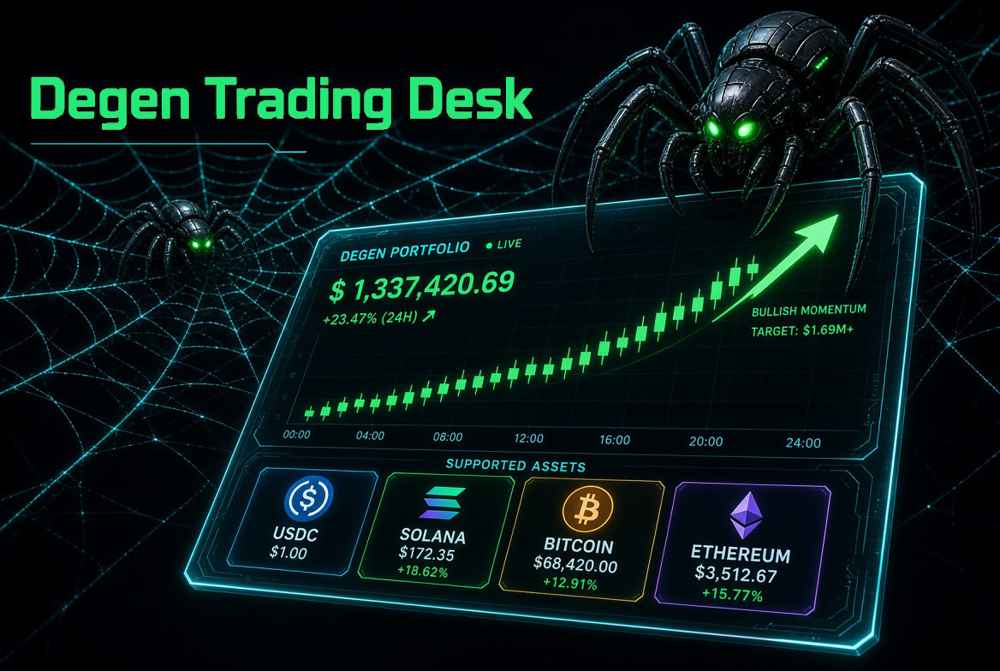

# Degen Trading Desk

**A rules-based crypto trading bot for Solana that runs itself, only takes trades that still profit after fees, and gives you a live animated dashboard. You set it up in about 10 minutes, without typing a single command.**

  

---

## What it does

- **Trades four coins on its own.** It moves a small Solana wallet between **USDC, SOL, Bitcoin (cbBTC) and Ether (WETH)**. That's all 6 pairs, in both directions.
- **Gets real quotes before every trade.** Each check ranks every route and quotes the 5 most promising ones on **Jupiter**, plus **Raydium** and **Orca** (through Jupiter). The best quote after fees wins, and the trade goes through at the price it was quoted.
- **Follows rules, not hunches.** It ships with 24 plain-English rules, such as "every trade must be profitable after all fees," "don't catch a falling knife" and "don't let one coin take over the wallet." You can change any of them.
- **Shows a live, animated dashboard.** Total balance, each coin's value, a balance-over-time chart, the holdings ring, recent trades with links to each transaction, live market prices and the **3 routes closest to trading**, with exactly why each one hasn't traded yet. It's hosted free on your own Cloudflare account and works on phones too.
- **Rebalances every day.** Twice a day it nudges the mix back into a healthy range, so no coin gets too big or too small. On Fridays an RSI check trims coins that have run too hot and buys ones that are oversold.
- **Has safety rules built in.**
  - It starts in **practice mode**, where nothing real trades until you say "go live".
  - A **"pause trading"** kill switch works anytime.
  - A daily loss stop, per-trade size caps and a SOL fee reserve are always on.
  - Every install and update gets a **security scan** first, and updates roll back automatically if anything fails.
- **Lets you test without risk.** Practice mode runs every rule against live prices and logs the trades it *would* make, so you can watch it for a day (or a week) before you put any money at risk.
- **Comes with optional extras, all off by default.**
  - *Interest mode:* lends half your USDC on Jupiter Lend and holds half your trading SOL as JitoSOL.
  - *Savings mode:* sets aside part of every gain as staked SOL.
  - *Memecoin mode:* just for fun, buys $1 of a memecoin for every $10 of growth.
  - *H093 preset:* a more active profile for strong uptrends.

## Quick start: set up in about 10 minutes

Degen Trading Desk installs as a **Grok Bot template**. Grok Bot does the setup work. You click a few buttons and paste a few keys.

1. **Install the template.** Add **Degen Trading Desk** from the Grok Bot templates: **[https://x.ai/bot/bILuY0HYImjO950URkzUE](https://x.ai/bot/bILuY0HYImjO950URkzUE)**. The bot downloads this engine, checks its sha256 against `engine-version.json`, runs a security scan and installs it.
2. **Create a few free accounts.** Sign in with Google once and the bot creates the accounts for you, or sign up with your email one site at a time. You need:
   - **Cloudflare** (hosts your dashboard; free plan)
   - **Helius** (connects to the Solana network; free tier)
   - **Jupiter** (trade quotes; free tier)
   - Optionally **Alchemy**, as a backup network connection

   You paste each key into a private box. Keys never go in the chat.
3. **Pick a wallet and extras in one reply.** Let the bot make a brand-new trading wallet (recommended), or use one you already have. Then choose any extras: savings, memecoin or interest mode.
4. **Check your dashboard.** It goes live on your own `*.workers.dev` address right away, still in practice mode.
5. **Fund the wallet.** Save the wallet backup first. Then send a small starting amount (for example $50 of SOL or USDC) and keep at least 0.02 SOL in it for network fees. The bot spots the deposit and uses that day's prices as your starting point.
6. **Decide after 24 hours.** The bot sends you a short check-in about its first day in practice mode. Tap **Go live** or **Keep practicing**.

It runs on Grok Bot first and checks prices every 5 minutes (this counts toward your Grok Bot usage). Whenever you like, say **"move it to my computer"** and it moves to your Windows PC, where it checks every minute at no extra cost. The dashboard stays at the same address.

> Running the engine by hand without Grok Bot isn't a supported setup yet. The readable source is in [`code/`](code/) if you want to see how it works.

## How it decides to trade

In plain English, every check goes like this:

1. **It remembers what it paid.** Each pair keeps a record of the rate of its own past trades, so the bot knows whether a coin is cheap or expensive *compared with what you paid*, not just compared with yesterday.
2. **It needs a real edge.** A swap only goes through when the live quote beats that remembered rate by a required margin. The margin starts at about 1%, and the bot makes it easier or harder depending on the situation:
   - It's easier to buy a coin you hold too little of, and harder to sell it.
   - It's easier to buy a coin that's below your average cost.
   - After a long quiet stretch with no trades, the margin is cut in half.
3. **It has to profit after every fee.** Network fees, priority fees, venue fees and slippage all come off first. A normal trade must still clear a small dollar profit, or it's skipped.
4. **It won't catch a falling knife.** If the coin it would buy is falling against the coin it would sell, compared with 24 hours ago, it waits.
5. **It reads the room.**
   - When the market is greedy (Fear & Greed above 75), it trades half size and doesn't buy coins with USDC.
   - When the market is fearful (Fear & Greed below 25), it doesn't sell coins into USDC.
   - When price impact or fees spike, it skips the trade.
6. **It keeps every trade small.** One trade is at most 15% of the portfolio and at most 40% of the coin being sold. It also stops after 3 trades in a row on the same pair.
7. **It can undo good trades for profit.** When the rate swings back far enough, it can reverse one of a pair's last few trades at the same size and lock in the difference.
8. **Rebalancing happens on a schedule, not on hunches.**
   - Twice a day it moves a slice of the way back toward its target mix. The USDC share follows the Fear & Greed index.
   - Once a week, the Friday RSI check trims overbought coins and buys oversold ones.

The dashboard's **"closest 3"** panel shows this reasoning live. A route says **clears** only when nothing is blocking it. Otherwise it shows how far short it is and the reason, such as *cooldown* or *fade-trend*, and it tags any send that failed.

## Configuration and switches

Most changes are just something you say to the bot:

| Say this | What happens |
|---|---|
| "pause trading" / "resume trading" | Kill switch. Every send is refused while paused. |
| "go live" | Leaves practice mode and starts real trades. |
| "turn interest mode on/off" | USDC lending + JitoSOL bucket (off by default). |
| "move it to my computer" | Moves to your Windows PC for 1-minute checks. |
| "update the bot" | Checks for a new engine version, scans it, and asks before installing. |

The files behind those switches, for anyone who wants to look:

| Setting | Where | Default |
|---|---|---|
| Practice (paper) mode | `config.json` `paper_trading` | `true` |
| Check interval | `config.json` `schedule.check_interval_sec_box` / `_pc` | 300 s hosted / 60 s on PC |
| Time zone for schedules and notes | `config.json` `timezone` | your time zone |
| Savings / memecoin / interest mode | `apply_features.py --savings/--memecoin/--interest on\|off` | all off |
| Trading rules (margins, size caps, hurdles, rebalance bands) | `cost-basis.json` (seeded from `code/seeds/cost-basis.seed.json`) | as shipped |
| H093 preset | `cost-basis.json` `"h093": {"enabled": true}` | **off** |

**About the H093 preset (optional, off by default).** It's one switch for a more active profile in strong uptrends:
- a same-pair streak cap of 5 instead of 3
- the margin halves after 30 quiet checks instead of 60
- reversals close up to 60% of the earlier trade instead of 85%
- the daily rebalance moves 15% of the gap instead of 10%
- smaller sells of SOL, Bitcoin and Ether into USDC while that coin is trending up

Turning it off restores your stored settings exactly, because it never overwrites them.

Rule changes are never made silently. The bot asks before it changes a live rule.

## FAQ

**Does it cost anything?**
There's no subscription. Cloudflare, Helius and Jupiter all have free tiers that cover this. You pay normal Solana network fees, which are tiny (usually around 0.01 SOL over a normal stretch of trading). While it runs on Grok Bot, it uses your Grok Bot usage. On your own PC it doesn't.

**Can it lose money?**
Yes. See the risk notice below. That's why it starts in practice mode and why the kill switch and loss stop exist.

**Who holds my keys?**
You do. The wallet key and API keys stay in your own install, are never pasted into chat, and never go into this repo. On Windows, the bot can encrypt them so only your user account can read them.

**Is there a backtester?**
Not in v1.1.2. The way to test it is practice mode: it runs every rule against live prices and records what it would have traded, with nothing real at risk.

**Which exchanges does it use?**
Jupiter, Raydium and Orca (through Jupiter), all on Solana. Trades are sent through your own Helius connection, with an optional Alchemy backup.

**Can other people see my dashboard?**
Anyone with the link can see balances and trades. It never shows your keys.

**How do updates work?**
Once a week the bot checks this repo's `engine-version.json`. If there's a new version, it downloads it, checks the hash, runs a security scan, and asks you first. If anything fails, it puts the old version back on its own. Your wallet, keys, settings and trade history are never touched.

**Can I change the coins or the rules?**
The rules are all in `cost-basis.json` and you can change any of them (ask the bot and it'll explain each one first). The coin set is fixed at USDC, SOL, cbBTC and WETH in this version.

## What's in this repo

| Path | What it is |
|---|---|
| `code/` | Readable engine source (Python, dashboard, Cloudflare Worker, scheduler scripts, offline tests) |
| `TRADING TEMPLATE ENGINE.txt` | The same files packed into one bundle with per-file sha256 hashes. The setup downloads this. |
| `engine-version.json` | Small manifest (version, release date, size and sha256 of the bundle). Update checks read only this file. |
| `requirements.txt` | Python dependencies (Python 3.11+) |
| `docs/` | README images |

## Risk notice and disclaimer

**This is experimental software that trades real cryptocurrency once live mode is on.**
- Crypto prices are volatile.
- Bugs, bad data, network problems, exchange or smart-contract failures, and the bot's own rules can all lose money.
- Past or simulated behavior says nothing about future results.

Use only money you can afford to lose.

**Nothing here is financial, investment or tax advice.** The software comes with **no warranty of any kind**. You're responsible for your own keys, wallet, trades and any taxes. Keep your `.env`, `config.json`, wallet and keys private. They're owner files and never belong in this repo.

## License

No license has been chosen yet, so all rights are reserved for now. You can read the code, but please ask before reusing it.
